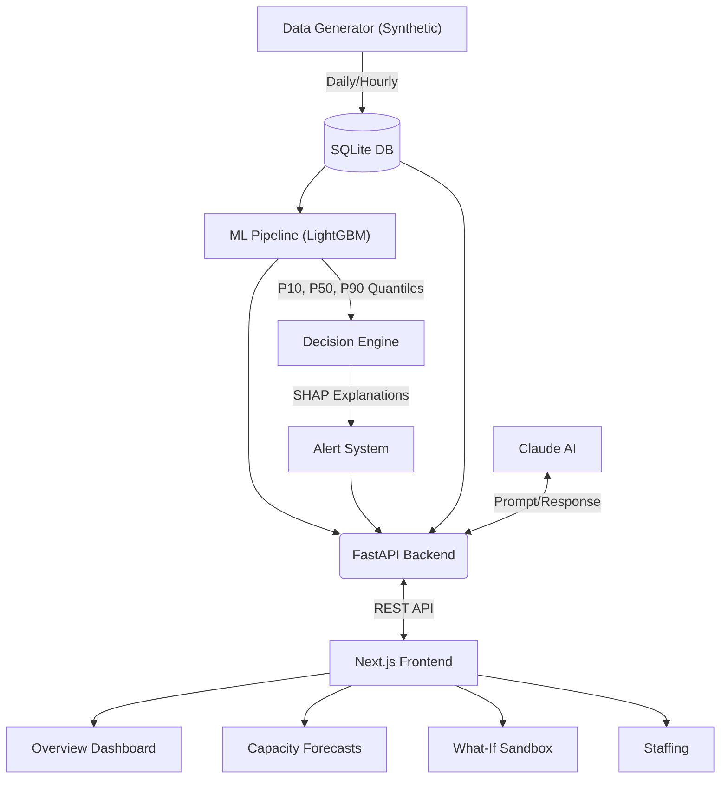

# MediCast: Intelligent Hospital Resource Utilization Prediction Framework

MediCast is a full-stack ML framework that predicts ICU/ward beds, ED arrivals, staff demand, and equipment use. It forecasts these metrics up to 14 days in the future, providing a decision support engine with SHAP explainability.

## Architecture



## Model Comparison (Test Set Metrics)

| Ward | LGBM MAE (P50) | SARIMA MAE | Naive MAE | Coverage (P10-P90) |
|---|---|---|---|---|
| Intensive Care Unit | 1.38 | 1.81 | 2.06 | ~80.0% |
| General Ward | 7.77 | 11.97 | 12.35 | ~80.0% |
| Emergency | 2.61 | 3.78 | 4.39 | ~80.0% |
| Maternity | 2.23 | 3.04 | 3.44 | ~80.0% |

*Results based on 2 years of simulated historical data using 85/15 time-based split.*

## Setup (One-Command Run)

Make sure you have Docker and Docker Compose installed.

1. Clone or navigate to the repository directory.
2. Run the following command:
   ```bash
   docker compose up --build
   ```
3. Wait for the build to finish. The database will be seeded automatically and the initial model pipeline will run.
4. Open your browser and navigate to `http://localhost:3000`.

## Testing

Backend unit tests cover the decision engine thresholds and verify that there is no data leakage in the time-based splits.

To run tests locally:
```bash
cd backend
pip install -r requirements.txt pytest
pytest test_ml.py
```

*Note: Simulated data. Decision support only, a human makes the final call.*
